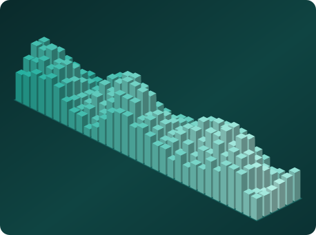

<!-- ░░░░░░░░░░░░░░░░░░░░░░░░ HEADER ░░░░░░░░░░░░░░░░░░░░░░░░ -->

  

  

  
  

 

<!-- ░░░░░░░░░░░░░░░░░░░░░░░░ ABOUT ░░░░░░░░░░░░░░░░░░░░░░░░ -->
<table align="center" width="100%">
  <tr>
    <td width="46%" align="center">
      
    </td>
    <td width="54%">
      <h2>ABOUT ME</h2>
      
      

        Full Stack software engineer who enjoys taking an idea from the
        <b>database schema</b> all the way to the <b>final user interface</b>.
        My strength lies in the backend: I design clean APIs, model data, and
        structure services so they stay easy to maintain as they scale.
      

      

        On the frontend, I build intuitive, engaging interfaces with fluid
        interactions, purposeful animation, and robust performance.
      

    </td>
  </tr>
</table>

 

<!-- ░░░░░░░░░░░░░░░░░░░░░░░░ STATUS ░░░░░░░░░░░░░░░░░░░░░░░░ -->
<h3 align="center">01 &nbsp;/&nbsp; CURRENTLY</h3>

<table align="center" width="100%">
  <tr>
    <td width="22%"><b>🏢 &nbsp;WORKING</b></td>
    <td>Intern at <b>Empresa Eléctrica</b>, learning in the field</td>
  </tr>
  <tr>
    <td><b>📱 &nbsp;LEARNING</b></td>
    <td>Leveling up <b>Flutter</b></td>
  </tr>
  <tr>
    <td><b>🤖 &nbsp;BUILDING</b></td>
    <td>AI-powered applications</td>
  </tr>
  <tr>
    <td><b>💬 &nbsp;ASK ME ABOUT</b></td>
    <td><b>Spring Boot</b> and <b>React</b></td>
  </tr>
  <tr>
    <td><b>🤝 &nbsp;WORKFLOW</b></td>
    <td>Team delivery with <b>Scrum</b> and <b>XP</b></td>
  </tr>
  <tr>
    <td><b>🎧 &nbsp;SOUNDTRACK</b></td>
    <td>Avicii, on repeat in every coding session</td>
  </tr>
</table>

 

<!-- ░░░░░░░░░░░░░░░░░░░░░░░░ STACK ░░░░░░░░░░░░░░░░░░░░░░░░ -->
<h3 align="center">02 &nbsp;/&nbsp; STACK</h3>

<table align="center" width="100%">
  <tr>
    <td align="center" width="50%">
      <b>LANGUAGES</b>  
      
    </td>
    <td align="center" width="50%">
      <b>FRAMEWORKS</b>  
      
    </td>
  </tr>
  <tr>
    <td align="center">
      <b>DATABASES &amp; BAAS</b>  
      
    </td>
    <td align="center">
      <b>CLOUD &amp; TOOLS</b>  
      
    </td>
  </tr>
</table>

  
  
  
  
  
  

 

<!-- ░░░░░░░░░░░░░░░░░░░░░░░░ METRICS ░░░░░░░░░░░░░░░░░░░░░░░░ -->
<h3 align="center">03 &nbsp;/&nbsp; ACTIVITY</h3>

  
  

  

  

  
  

 

<!-- ░░░░░░░░░░░░░░░░░░░░░░░░ QUOTE ░░░░░░░░░░░░░░░░░░░░░░░░ -->

*"Stand up and walk. Keep moving forward.*
*You're strong enough to make your own path."*

<b>EDWARD ELRIC</b> · FULLMETAL ALCHEMIST

 

<!-- ░░░░░░░░░░░░░░░░░░░░░░░░ FOOTER ░░░░░░░░░░░░░░░░░░░░░░░░ -->

  

  

